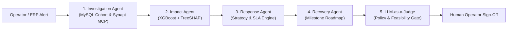

# Standard Operating Procedures (SOP) Framework
## AI-Powered Supply Chain Disruption & Crisis Management System

**Document Control:**
- **System Version:** 2.0.0
- **Governing Architecture:** Project 9 — AI-Powered Supply Chain Disruption Assistant with Synapt
- **Ontology Authority:** Synapt Trident MCP (`v_disruption_details` schema & controlled classes)
- **Effective Date:** October 2026
- **Status:** Active Enterprise Standard

---

## 1. Executive Summary & Purpose

This Standard Operating Procedure (SOP) framework defines the end-to-end incident response, containment, mitigation, and recovery protocols for enterprise supply chain operations. 

Grounded in an empirical warehouse of **100,000 historical disruptions**, validated predictive machine learning models (XGBoost $R^2 \ge 0.70$), TreeSHAP root-cause explainability, and multi-agent coordination with **LLM-as-a-Judge** governance, these SOPs provide deterministic, auditable playbooks for incident operators, supply chain directors, and executive stakeholders.

---

## 2. Directory Index of Disruption SOPs

| Procedure ID | Disruption Type | Empirical Frequency | Avg. Downtime | Avg. Revenue Loss | Benchmark Recovery | Primary Empirical Strategy |
| :--- | :--- | :--- | :--- | :--- | :--- | :--- |
| [**SOP-01**](./SOP-01_FACTORY_INCIDENT.md) | **Factory Incident** | 11,878 cases (11.9%) | 29.58% | $2,359,573 | 71.3 days | Alternative Supplier / Reroute |
| [**SOP-02**](./SOP-02_CYBER_ATTACK.md) | **Cyber Attack** | 14,887 cases (14.9%) | 41.31% | $3,365,434 | 99.6 days | Emergency Air Freight / EDI Bypass |
| [**SOP-03**](./SOP-03_PORT_CONGESTION.md) | **Port Congestion** | 25,118 cases (25.1%) | 24.34% | $1,963,051 | 59.1 days | Multimodal Rerouting / Dual Ports |
| [**SOP-04**](./SOP-04_LABOR_STRIKE.md) | **Labor Strike** | 15,017 cases (15.0%) | 26.00% | $2,033,352 | 62.8 days | Safety Stock Buffer / Intermodal Shift |
| [**SOP-05**](./SOP-05_GEOPOLITICAL.md) | **Geopolitical** | 18,084 cases (18.1%) | 33.86% | $2,691,691 | 81.2 days | Regional Nearshoring / Secondary Source |
| [**SOP-06**](./SOP-06_NATURAL_DISASTER.md) | **Natural Disaster** | 15,016 cases (15.0%) | 37.33% | $3,039,002 | 90.6 days | Crisis Inventory Release / Alternative Hub |

---

## 3. Incident Severity & Triage Classification Matrix

Every disruption entering the system is evaluated along a standardized 5-point severity scale and triaged into operational priority tiers:

```
+---------------------------------------------------------------------------------------------------+
| PRIORITY TIER | SEVERITY LEVEL | DOWNTIME EXPECTATION | REVENUE IMPACT THRESHOLD | SLA TO MITIGATE |
+---------------+----------------+----------------------+--------------------------+-----------------+
| P1-Critical   | Level 5        | > 50% Downtime       | > $3,500,000             | < 4 Hours       |
| P2-High       | Level 4        | 35% - 50% Downtime   | $2,000,000 - $3,500,000  | < 12 Hours      |
| P3-Medium     | Level 2 - 3    | 15% - 35% Downtime   | $500,000 - $2,000,000    | < 24 Hours      |
| P4-Low        | Level 1        | < 15% Downtime       | < $500,000               | < 48 Hours      |
+---------------------------------------------------------------------------------------------------+
```

---

## 4. Multi-Agent Orchestration Architecture in SOP Execution

When an incident operator detects or receives an alert, the Synapt Multi-Agent Pipeline executes five automated stages that support each SOP:



1. **Investigation Agent**: Queries `v_disruption_details` for top matching historical analogs based on industry, supplier tier, region, and disruption type.
2. **Impact Agent**: Feeds incident parameters into trained XGBoost regressors to predict downtime percentage, revenue loss, and recovery duration, attributing variance through TreeSHAP.
3. **Response Agent**: Formulates empirical response strategies (`Alternative Supplier`, `Inventory Buffer`, `Production Reroute`, `Customer Delay`, or `Combined Strategy`).
4. **Recovery Agent**: Constructs a 4-phase milestone restoration trajectory and calculates permanent supplier churn risk.
5. **LLM-as-a-Judge**: Rigorously evaluates response feasibility against operational guardrails, budget limits, lead times, and regulatory constraints before presenting the Executive Dossier.

---

## 5. RACI Governance Matrix Across Disruption Lifecycle

| Role | Investigation & Triage | ML Impact Modeling | Strategy Selection | Milestone Execution | Audit & Sign-Off |
| :--- | :---: | :---: | :---: | :---: | :---: |
| **Incident Commander (Supply Chain VP)** | A | I | A | A | A |
| **Crisis Operations Manager** | R | R | R | R | R |
| **Procurement & Category Lead** | C | C | R | R | C |
| **Logistics & Freight Coordinator** | C | I | R | R | I |
| **Synapt AI Multi-Agent Coordinator** | R | R | R | C | C |
| **LLM-as-a-Judge Auditor** | C | C | C | C | R |

*Legend: **R** = Responsible, **A** = Accountable, **C** = Consulted, **I** = Informed*

---

## 6. General Operating Principles

1. **Deterministic First, Autonomous Second**: All numerical projections (loss, downtime, days) are derived strictly from empirical models and validated SQL cohorts, not hallucinated generative tokens.
2. **Mandatory Redundancy Validation**: Any Tier-1 or Tier-2 supplier without an active qualified backup must be immediately flagged for expedited second-source onboarding.
3. **Continuous Feedback Loop**: Every operator override or acceptance is logged to the governance database to continuously train and calibrate future response policies.
