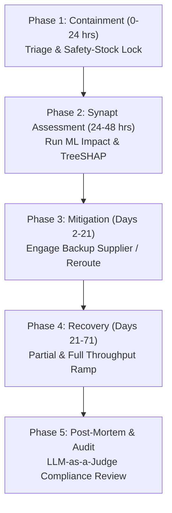

# Standard Operating Procedure: Factory Incident Response
## SOP-01: Manufacturing & Facility Failure Disruption Playbook

```
+----------------------------------------------------------------------------------------------------+
| PROCEDURE ID: SOP-01                  | VERSION: 2.1              | STATUS: ACTIVE                 |
| CLASSIFICATION: Factory Incident     | EFFECTIVE DATE: Oct 2026  | REVIEW CYCLE: Semi-Annual      |
| GOVERNING SYSTEM: Synapt Assistant    | DATABASE COHORT: 11,878   | BENCHMARK RESILIENCE: 79.88%   |
+----------------------------------------------------------------------------------------------------+
```

---

## 1. Scope & Incident Description

This SOP governs emergency response and operational continuity procedures when an active component manufacturing plant, assembly facility, or raw-material processing center experiences an unexpected shutdown or severe operational impairment.

### Typical Root Causes
- Industrial fires, chemical spills, or industrial explosions.
- Critical equipment or tooling breakdown (e.g., semiconductor cleanroom contamination, stamping press failure).
- Facility structural compromise or localized utility grid collapse.
- Severe regulatory or occupational safety shutdowns (OSHA/ISO compliance halts).

---

## 2. Empirical Warehouse Baseline & Performance Benchmarks

Based on 11,878 recorded historical factory incidents in `v_disruption_details`:

- **Empirical Probability**: 11.9% of all supply chain disruptions.
- **Mean Production Downtime**: **29.58%**
- **Mean Financial Revenue Loss**: **$2,359,573.42**
- **Mean Time to Full Recovery (MTFR)**: **71.3 days**
- **Empirical Strategy Effectiveness**:
  1. **Alternative Supplier**: Mean Resilience = **84.16%**, Avg Recovery = **58.9 days** *(Rank #1)*
  2. **Inventory Buffer**: Mean Resilience = **77.00%**, Avg Recovery = **69.2 days**
  3. **Customer Delay**: Mean Resilience = **76.40%**, Avg Recovery = **80.4 days**
  4. **Production Reroute**: Mean Resilience = **75.71%**, Avg Recovery = **86.7 days**
  5. **Combined Strategy**: Mean Resilience = **75.06%**, Avg Recovery = **92.8 days**

> [!IMPORTANT]
> Historical evidence demonstrates that immediately activating a pre-qualified **Alternative Supplier** yields an **84.16% resilience score** and cuts recovery duration by **12.4 days** compared to internal rerouting.

---

## 3. Incident Severity Triage Matrix

```
+----------+-------------------+--------------------+------------------------+-----------------------+
| SEVERITY | CLASSIFICATION    | EXPECTED DOWNTIME  | ESTIMATED LOSS         | ESCALATION LEVEL      |
+----------+-------------------+--------------------+------------------------+-----------------------+
| Level 1  | Minor Breakdown   | < 10% Downtime     | < $300,000 USD         | Plant Floor Lead      |
| Level 2  | Moderate Incident | 10% - 25% Downtime | $300,000 - $1,000,000  | Category Manager      |
| Level 3  | Significant Halt  | 25% - 40% Downtime | $1,000,000 - $2,500,000| Crisis Response Team  |
| Level 4  | Major Facility Out| 40% - 60% Downtime | $2,500,000 - $4,500,000| VP Supply Chain       |
| Level 5  | Total Destruction | > 60% Downtime     | > $4,500,000 USD       | C-Suite / Executive   |
+----------+-------------------+--------------------+------------------------+-----------------------+
```

---

## 4. Phased Standard Operating Procedure



### Phase 1: Immediate Triage & Containment (Hours 0 – 24)
1. **Facility Status Verification**: Obtain formal written notification or telemetry alert from supplier's EHS/Plant Operations director verifying incident scope.
2. **Safety Stock Quarantine**: Identify in-transit inventory and lock existing warehouse safety-stock buffers for critical downstream assembly lines.
3. **Bill of Materials (BOM) Impact Sweep**: Determine all finished goods SKUs reliant on the affected component.
4. **Trigger Synapt Ingestion**: Ingest incident parameters into the Synapt Crisis Response Center (`/api/v1/orchestrate`).

### Phase 2: Agent-Assisted Assessment (Hours 24 – 48)
1. **Investigation Agent Check**: Evaluate 25 analog historical factory disruption cohorts matching the industry, tier, and region.
2. **Impact Agent ML Forecast**: Inspect predicted downtime percentage, revenue loss, and TreeSHAP waterfall charts. Identify primary driver (e.g., `supplier_tier`, `has_backup_supplier`).
3. **Redundancy Validation**:
   - If `has_backup_supplier == True`: Issue immediate Purchase Order reallocation for up to 60% of baseline volume.
   - If `has_backup_supplier == False`: Flag as Single-Source High Risk and mandate immediate alternate supplier discovery.

### Phase 3: Mitigation Deployment (Days 2 – 21)
1. **Alternative Supplier Onboarding**: If secondary supplier active, ramp order volumes within 21-day SLA window.
2. **Tooling & Die Transfer Assessment**: For Tier-1 automotive/aerospace components, verify if proprietary tooling can be transported or duplicated.
3. **Production Reroute Protocol**: If alternate suppliers are capacity-constrained, activate secondary sister manufacturing plants.
4. **Logistics Expedite**: Book priority ground/air freight for intermediate sub-assemblies.

### Phase 4: Restoration & Ramp-Up (Days 21 – 71)
1. **Milestone 1 (Target: Day 21)**: Secondary sourcing active; first emergency shipment lands.
2. **Milestone 2 (Target: Day 35)**: Production capacity restored to **50% throughput**.
3. **Milestone 3 (Target: Day 55)**: Plant repairs or secondary line volume clears 80% of customer order backlog.
4. **Milestone 4 (Target: Day 71)**: Full 100% throughput re-established.

### Phase 5: Post-Incident Governance & Audit (Post Day 71)
1. **LLM-as-a-Judge Audit**: Submit operational log and recovery metrics to the AI Judge for compliance verification.
2. **Supplier Churn Risk Review**: Review permanent supplier change probability (empirical mean: 22.3%).
3. **Contractual Penalty Settlement**: Reconcile SLA liquidated damages and business interruption insurance claims.
4. **Operator Sign-Off**: Record final executive rating and comments in the Governance Registry.

---

## 5. Decision Tree for Response Strategy Selection

```
Is a qualified Backup Supplier available?
├── YES
│   └── Disruption Severity ≥ 3?
│       ├── YES ──> Deploy 'Alternative Supplier' (PO reallocation + Expedited Freight)
│       └── NO  ──> Deploy 'Inventory Buffer' + Maintain Monitored Supplier Status
└── NO
    └── Can existing inventory buffer cover > 45 days of demand?
        ├── YES ──> Deploy 'Inventory Buffer' + Monitor Plant Restoration Daily
        └── NO  ──> Deploy 'Combined Strategy' (Reroute Production + Emergency Sourcing)
```

---

## 6. Communication & Escalation Cadence

| Stakeholder Group | Frequency | Method | Information Required |
| :--- | :--- | :--- | :--- |
| **Executive Leadership** | Daily (P1/P2) / Bi-weekly (P3) | Executive Dossier Export | Predicted revenue at risk, downtime %, SLA adherence |
| **Downstream Customers** | Within 48 hours | Formal Advisory Notice | Revised ship dates, critical order protection status |
| **Affected Supplier** | Daily 09:00 UTC | Standup Operations Call | Structural repair timeline, workforce return status |
| **Tier-2 Sub-Suppliers** | Weekly | Procurement Notice | Forecast adjustments, shipment holding instructions |
