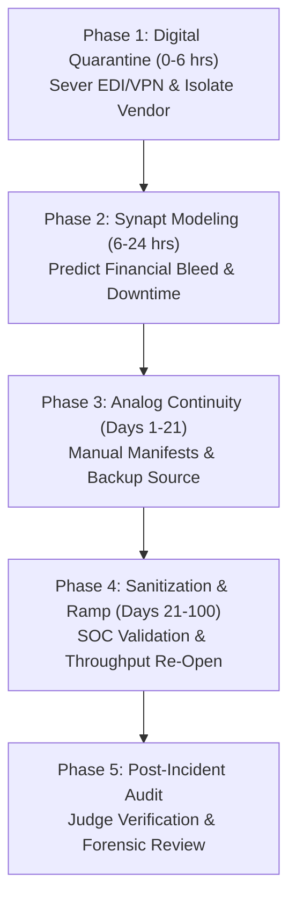

# Standard Operating Procedure: Cyber Attack Response
## SOP-02: Information Security & Digital Supply Chain Disruption Playbook

```
+----------------------------------------------------------------------------------------------------+
| PROCEDURE ID: SOP-02                  | VERSION: 2.1              | STATUS: ACTIVE                 |
| CLASSIFICATION: Cyber Attack         | EFFECTIVE DATE: Oct 2026  | REVIEW CYCLE: Semi-Annual      |
| GOVERNING SYSTEM: Synapt Assistant    | DATABASE COHORT: 14,887   | BENCHMARK RESILIENCE: 77.60%   |
+----------------------------------------------------------------------------------------------------+
```

---

## 1. Scope & Incident Description

This SOP governs protocols for containment, air-gapping, supply continuity, and operational recovery when a critical supplier, logistics carrier, or key vendor suffers a ransomware infiltration, malware infection, unauthorized data exfiltration, or complete Electronic Data Interchange (EDI) / Enterprise Resource Planning (ERP) network outage.

### Typical Root Causes
- Ransomware encryption locking inventory tracking, automated picking, or shipping manifests.
- Industrial Control System (ICS/SCADA) malware disabling automated assembly lines.
- Distributed Denial-of-Service (DDoS) or man-in-the-middle attack paralyzing supplier EDI gateways.
- Third-party SaaS supply chain platform outage (e.g., TMS/WMS cloud provider failure).

---

## 2. Empirical Warehouse Baseline & Performance Benchmarks

Based on 14,887 recorded historical cyber attacks in `v_disruption_details`:

- **Empirical Probability**: 14.9% of all supply chain disruptions.
- **Mean Production Downtime**: **41.31%** *(Highest across all categories)*
- **Mean Financial Revenue Loss**: **$3,365,433.78** *(Highest across all categories)*
- **Mean Time to Full Recovery (MTFR)**: **99.6 days** *(Longest recovery cycle)*
- **Empirical Strategy Effectiveness**:
  1. **Alternative Supplier**: Mean Resilience = **82.68%**, Avg Recovery = **81.5 days** *(Rank #1)*
  2. **Inventory Buffer**: Mean Resilience = **76.33%**, Avg Recovery = **80.8 days**
  3. **Customer Delay**: Mean Resilience = **75.37%**, Avg Recovery = **99.6 days**
  4. **Production Reroute**: Mean Resilience = **72.99%**, Avg Recovery = **122.9 days**
  5. **Combined Strategy**: Mean Resilience = **72.30%**, Avg Recovery = **125.2 days**

> [!CAUTION]
> Cyber attacks represent the highest financial ($3.37M) and operational (41.31% downtime) severity in the supply chain. Internal rerouting takes an average of **122.9 days**, whereas immediate deployment of a pre-vetted **Alternative Supplier** saves **41.4 days** of disruption.

---

## 3. Incident Severity Triage Matrix

```
+----------+--------------------+--------------------+------------------------+-----------------------+
| SEVERITY | CLASSIFICATION     | EXPECTED DOWNTIME  | ESTIMATED LOSS         | ESCALATION LEVEL      |
+----------+--------------------+--------------------+------------------------+-----------------------+
| Level 1  | Isolated Phishing  | < 15% Downtime     | < $500,000 USD         | InfoSec Lead          |
| Level 2  | Localized Outage   | 15% - 30% Downtime | $500,000 - $1,500,000  | CISO & Category Lead  |
| Level 3  | Vendor EDI Down    | 30% - 45% Downtime | $1,500,000 - $3,500,000| Crisis Response Team  |
| Level 4  | Ransomware Active  | 45% - 60% Downtime | $3,500,000 - $5,500,000| VP Supply & CISO      |
| Level 5  | Complete OT Lockout| > 60% Downtime     | > $5,500,000 USD       | Board & Executive     |
+----------+--------------------+--------------------+------------------------+-----------------------+
```

---

## 4. Phased Standard Operating Procedure



### Phase 1: Digital Containment & Network Isolation (Hours 0 – 6)
1. **Sever Direct Network Links**: Immediately terminate all VPN connections, direct API integrations, and AS2/SFTP EDI tunnels connecting the vendor to internal enterprise networks.
2. **Quarantine In-Flight Transactions**: Freeze automatic PO approvals, advance shipping notices (ASNs), and electronic funds transfers (EFT) pending verification.
3. **Notify Enterprise Cyber Incident Response Team (CIRT)**: Engage Corporate Information Security (InfoSec) to verify no lateral movement into enterprise systems.
4. **Trigger Synapt Ingestion**: Ingest vendor metadata into `/api/v1/orchestrate` with categorical flag `Cyber Attack`.

### Phase 2: Agent-Assisted Assessment & Strategy Selection (Hours 6 – 24)
1. **Impact Agent Run**: Review XGBoost downtime forecast and TreeSHAP attribution drivers.
2. **Supplier Air-Gap Validation**: Confirm with vendor whether operational technology (factory machines/robots) or only informational technology (office PCs/billing) is encrypted.
3. **Formulate Response Strategy**:
   - For Severity $\ge 3$: Immediately issue manual Purchase Orders to secondary supplier (`Alternative Supplier` protocol).
   - Authorize offline analog processing: activate paper manifests and verified telephone authorization for existing warehouse shipments.

### Phase 3: Mitigation & Operational Continuity (Days 1 – 21)
1. **Bypass Sourcing Activation**: Route 40% – 70% of component volume to secondary non-compromised vendor.
2. **Alternative Communications Channel**: Establish encrypted out-of-band communication (Signal / secure isolated web portal) with vendor executive team.
3. **Inventory Re-allocation**: Deplete existing buffer stock to maintain downstream production line operations without interruption.

### Phase 4: Systems Sanitization & Phased Restoration (Days 21 – 100)
1. **Milestone 1 (Target: Day 21)**: Alternative sourcing live; secondary shipments arriving at assembly hubs.
2. **Milestone 2 (Target: Day 45)**: Partial recovery: vendor cleans critical OT servers; manual shipping restores 50% capacity.
3. **Milestone 3 (Target: Day 75)**: Vendor re-establishes certified clean EDI connections under SOC-2/ISO 27001 auditor oversight.
4. **Milestone 4 (Target: Day 100)**: Full 100% throughput restored; zero backlog.

### Phase 5: Post-Incident Governance & Audit (Post Day 100)
1. **Third-Party Security Attestation**: Require vendor to provide independent SOC audit confirming complete malware eradication before reconnecting automated pipelines.
2. **LLM-as-a-Judge Audit**: Execute automated audit evaluation on downtime and financial variance.
3. **Review Permanent Supplier Change**: Evaluate if vendor contract should be terminated due to cyber hygiene negligence.

---

## 5. Decision Tree for Response Strategy Selection

```
Is vendor Operational Technology (OT / factory floor) infected?
├── YES (Production physically halted)
│   ├── Is Backup Supplier available?
│   │   ├── YES ──> Deploy 'Alternative Supplier' (Emergency PO reallocation)
│   │   └── NO  ──> Deploy 'Combined Strategy' (Reroute sister plants + Expedite sourcing)
│   └──
└── NO (Only IT / billing / email compromised)
    ├── Can shipments proceed via manual paper / verified manifests?
    │   ├── YES ──> Deploy 'Inventory Buffer' + Analog Manifest Protocol
    │   └── NO  ──> Deploy 'Alternative Supplier' until EDI restored
```

---

## 6. Information Security & Compliance Checklist

- [ ] All network links (SFTP, API, EDI, VPN) between vendor and enterprise severed within 2 hours.
- [ ] No internal credentials or certificates reused with affected vendor.
- [ ] Forensic root-cause analysis received from vendor within 14 days.
- [ ] No ransom payments authorized or facilitated by enterprise personnel.
- [ ] Clean-slate penetration test report received prior to reconnection.
