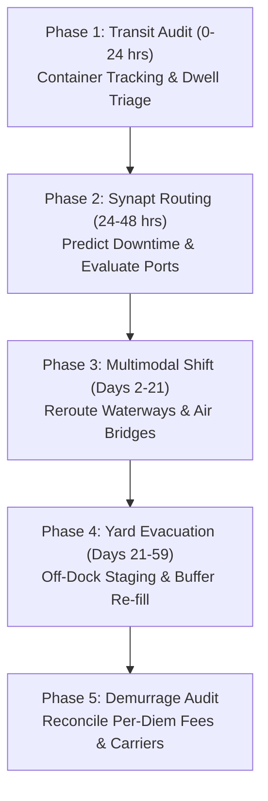

# Standard Operating Procedure: Port Congestion Response
## SOP-03: Maritime Terminal Bottleneck & Freight Gridlock Playbook

```
+----------------------------------------------------------------------------------------------------+
| PROCEDURE ID: SOP-03                  | VERSION: 2.1              | STATUS: ACTIVE                 |
| CLASSIFICATION: Port Congestion      | EFFECTIVE DATE: Oct 2026  | REVIEW CYCLE: Semi-Annual      |
| GOVERNING SYSTEM: Synapt Assistant    | DATABASE COHORT: 25,118   | BENCHMARK RESILIENCE: 80.76%   |
+----------------------------------------------------------------------------------------------------+
```

---

## 1. Scope & Incident Description

This SOP defines rapid rerouting, dwell-time containment, container de-consolidation, and alternative port gateway procedures when major marine container terminals experience critical backlogs, vessel anchor queue buildups, chassis shortages, or customs clearance bottlenecks.

### Typical Root Causes
- Massive import container surges exceeding container yard gate capacity.
- Intermodal rail/truck chassis shortages preventing box evacuation.
- Terminal operating system (TOS) software failures or customs IT halts.
- Berthing bottlenecks, vessel bunching, or severe weather harbor channel closures.

---

## 2. Empirical Warehouse Baseline & Performance Benchmarks

Based on 25,118 recorded historical port congestion events in `v_disruption_details`:

- **Empirical Probability**: **25.1%** *(Most frequent disruption type in global trade)*
- **Mean Production Downtime**: **24.34%**
- **Mean Financial Revenue Loss**: **$1,963,050.99**
- **Mean Time to Full Recovery (MTFR)**: **59.1 days** *(Fastest benchmark recovery)*
- **Empirical Strategy Effectiveness**:
  1. **Alternative Supplier / Secondary Port**: Mean Resilience = **86.28%**, Avg Recovery = **47.7 days** *(Rank #1)*
  2. **Inventory Buffer**: Mean Resilience = **77.52%**, Avg Recovery = **60.0 days**
  3. **Production Reroute**: Mean Resilience = **77.24%**, Avg Recovery = **65.0 days**
  4. **Customer Delay**: Mean Resilience = **76.93%**, Avg Recovery = **72.5 days**

> [!TIP]
> Port congestion exhibits the highest baseline resilience (80.76%) because physical inventory is rarely destroyed—it is delayed in transit. Transitioning inbound freight to an **Alternative Supplier or Secondary Port** achieves an **86.28% resilience score** and reduces average recovery to **47.7 days**.

---

## 3. Incident Severity Triage Matrix

```
+----------+--------------------+---------------------+------------------------+-----------------------+
| SEVERITY | CLASSIFICATION     | VESSEL ANCHOR DELAY | ESTIMATED LOSS         | ESCALATION LEVEL      |
+----------+--------------------+---------------------+------------------------+-----------------------+
| Level 1  | Minor Gate Delay   | 3 - 5 days delay    | < $250,000 USD         | Freight Forwarder     |
| Level 2  | Berth Bottleneck   | 6 - 12 days delay   | $250,000 - $800,000    | Logistics Manager     |
| Level 3  | Severe Terminal Lag| 13 - 21 days delay  | $800,000 - $2,000,000  | Director Global Trade |
| Level 4  | Regional Gridlock  | 22 - 35 days delay  | $2,000,000 - $3,500,000| VP Supply Chain       |
| Level 5  | Catastrophic Lock  | > 35 days delay     | > $3,500,000 USD       | Executive Committee   |
+----------+--------------------+---------------------+------------------------+-----------------------+
```

---

## 4. Phased Standard Operating Procedure



### Phase 1: In-Transit Container Audit & Triage (Hours 0 – 24)
1. **Container Manifest Extraction**: Pull complete bill of lading (B/L) roster for all containers aboard vessels currently anchored, scheduled, or idling at the congested port.
2. **Prioritization Tagging**:
   - Tag **Critical Assembly Line Stoppers** (High Priority).
   - Tag **Standard Finished Goods** (Medium Priority).
   - Tag **General Replenishment Stock** (Low Priority).
3. **AIS Telemetry Verification**: Verify vessel position, expected time of berthing (ETB), and expected time of departure (ETD) via maritime tracking APIs.
4. **Trigger Synapt Ingestion**: Ingest port incident parameters into `/api/v1/orchestrate` with categorical type `Port Congestion`.

### Phase 2: Agent-Assisted Assessment & Strategy Formulation (Hours 24 – 48)
1. **Synapt Investigation Agent**: Query analogous historical port congestion events (e.g., Los Angeles/Long Beach, Rotterdam, Shanghai).
2. **Evaluate Alternative Inbound Gateways**:
   - For West Coast congestion $\rightarrow$ Assess Pacific Northwest (Seattle/Tacoma), Canadian (Prince Rupert/Vancouver), or Panama Canal bypass to Gulf ports.
   - For European congestion $\rightarrow$ Assess Antwerp, Hamburg, or Mediterranean gateways.
3. **Impact Agent ML Model Evaluation**: Check predicted downtime percentage and financial loss from TreeSHAP waterfall model.

### Phase 3: Multimodal Diversion & Execution (Days 2 – 21)
1. **Mid-Ocean Carrier Diverts**: Issue Carrier Amendment Requests (CAR) to ocean lines to discharge future containers at secondary non-congested ports.
2. **Emergency Air Freight Bridge**: For Level 4/5 disruptions where assembly stoppage is imminent within 7 days, convert 5%–10% of critical component volume from ocean to dedicated charter air cargo.
3. **Off-Dock Yard Staging**: Contract with inland off-dock container yards (CY) to "peel off" containers directly from vessel hook, bypassing congested terminal gates.
4. **Transloading & Cross-Docking**: De-consolidate marine ISO containers into 53-foot domestic dry vans to bypass rail ramp dwell queues.

### Phase 4: Container Evacuation & Throughput Ramp (Days 21 – 59)
1. **Milestone 1 (Target: Day 15)**: Air bridge components land; emergency production lines stabilized.
2. **Milestone 2 (Target: Day 30)**: Diverted vessels berthing at secondary ports; intermodal rail flowing smoothly.
3. **Milestone 3 (Target: Day 45)**: Terminal congestion clears; average container dwell time drops below 4 days.
4. **Milestone 4 (Target: Day 59)**: Full normal lead-times and safety-stock inventories restored.

### Phase 5: Demurrage Reconciliation & Governance Audit (Post Day 59)
1. **Demurrage & Detention Dispute Review**: Audit and dispute unfair per-diem and demurrage fees billed during terminal gridlocks under FMC / regulatory fair-practice rules.
2. **Carrier Performance Scorecard**: Update ocean carrier on-time reliability metrics.
3. **LLM-as-a-Judge Audit**: Execute governance check on emergency freight spend vs. avoided line downtime costs.

---

## 5. Decision Tree for Response Strategy Selection

```
Can ocean vessel be diverted to secondary port prior to arrival?
├── YES
│   └── Divert vessel & arrange intermodal rail to destination factory
└── NO (Vessel already in anchor queue / waiting berth)
    ├── Are components line-critical within 10 days?
    │   ├── YES ──> Activate Emergency Air Freight for 10% volume + Reroute remaining
    │   └── NO  ──> Engage Off-Dock Transloader + Utilize Local Safety Stock Buffer
```

---

## 6. Port Logistics Action Checklist

- [ ] Every container ID mapped to affected SKU and assembly plant within 12 hours.
- [ ] Ocean carrier notified of diversion requests before vessel enters territorial waters.
- [ ] Air freight forwarder pre-allocated space for top 5 critical SKUs.
- [ ] Demurrage clock paused via formal terminal force majeure / congestion notifications.
- [ ] Transload facility verified for 24/7 gate operations.
