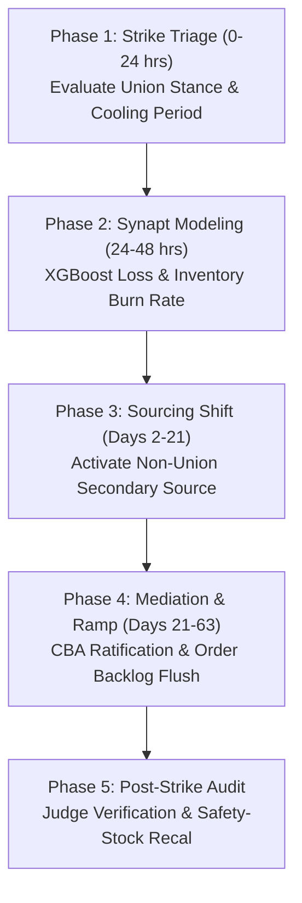

# Standard Operating Procedure: Labor Strike Response
## SOP-04: Workforce Walkout & Collective Bargaining Disruption Playbook

```
+----------------------------------------------------------------------------------------------------+
| PROCEDURE ID: SOP-04                  | VERSION: 2.1              | STATUS: ACTIVE                 |
| CLASSIFICATION: Labor Strike         | EFFECTIVE DATE: Oct 2026  | REVIEW CYCLE: Semi-Annual      |
| GOVERNING SYSTEM: Synapt Assistant    | DATABASE COHORT: 15,017   | BENCHMARK RESILIENCE: 80.39%   |
+----------------------------------------------------------------------------------------------------+
```

---

## 1. Scope & Incident Description

This SOP establishes standardized action plans for mitigating the operational and financial impact when unionized labor, transport workers, dockworkers, rail engineers, or supplier manufacturing personnel engage in work-to-rule actions, wildcat walkouts, organized picketing, or nationwide strikes.

### Typical Root Causes
- Master contract expiration without ratified collective bargaining agreements (CBA).
- Wage, pension, automation disputes, or working hours grievances.
- Sympathy strikes across interconnected transport sectors (e.g., truckers refusing to cross dockworker picket lines).
- Regional political or public-sector general strikes paralyzing freight networks.

---

## 2. Empirical Warehouse Baseline & Performance Benchmarks

Based on 15,017 recorded historical labor strike events in `v_disruption_details`:

- **Empirical Probability**: **15.0%** of all historical disruptions.
- **Mean Production Downtime**: **26.00%**
- **Mean Financial Revenue Loss**: **$2,033,352.27**
- **Mean Time to Full Recovery (MTFR)**: **62.8 days**
- **Empirical Strategy Effectiveness**:
  1. **Alternative Supplier**: Mean Resilience = **84.40%**, Avg Recovery = **52.9 days** *(Rank #1)*
  2. **Inventory Buffer**: Mean Resilience = **77.74%**, Avg Recovery = **60.1 days**
  3. **Customer Delay**: Mean Resilience = **76.76%**, Avg Recovery = **74.5 days**
  4. **Production Reroute**: Mean Resilience = **76.45%**, Avg Recovery = **75.9 days**
  5. **Combined Strategy**: Mean Resilience = **75.77%**, Avg Recovery = **77.8 days**

> [!NOTE]
> Unlike unforeseen physical disasters, 70% of labor strikes feature pre-strike contract expiration cooling-off periods. Proactively buffering stock prior to contract deadlines, combined with shifting purchase volumes to non-union or secondary suppliers upon walkout, yields an **84.40% resilience score**.

---

## 3. Incident Severity Triage Matrix

```
+----------+--------------------+---------------------+------------------------+-----------------------+
| SEVERITY | CLASSIFICATION     | STRIKE SCOPE        | ESTIMATED LOSS         | ESCALATION LEVEL      |
+----------+--------------------+---------------------+------------------------+-----------------------+
| Level 1  | Work-to-Rule / Slow| Single department   | < $300,000 USD         | Plant HR & Category   |
| Level 2  | Local Plant Walkout| Single supplier plant| $300,000 - $900,000   | Procurement Lead      |
| Level 3  | Multi-Site Strike  | Supplier entire org | $900,000 - $2,200,000  | Crisis Response Team  |
| Level 4  | National Transport | Nationwide rail/dock| $2,200,000 - $4,000,000| VP Supply Chain       |
| Level 5  | General Strike     | Total sector shutdown| > $4,000,000 USD      | Executive Leadership  |
+----------+--------------------+---------------------+------------------------+-----------------------+
```

---

## 4. Phased Standard Operating Procedure



### Phase 1: Strike Scope Triage & Inventory Burn Calculation (Hours 0 – 24)
1. **Determine Picket & Strike Boundaries**: Establish if the strike affects physical plant gates, transport carriers (truck/rail), or external port stevedoring.
2. **Calculate Days of Inventory (DOI)**: Compute current on-hand component inventory at destination factories:
   $$\text{Days of Inventory} = \frac{\text{Current Stock (units)}}{\text{Average Daily Consumption (units)}}$$
3. **Picket Line Crossing Legalities**: Verify with third-party logistics (3PL) carriers whether Teamster/union transport drivers will cross picket lines to pull finished goods from warehouses.
4. **Trigger Synapt Ingestion**: Ingest parameters into `/api/v1/orchestrate` with categorical type `Labor Strike`.

### Phase 2: Agent-Assisted Assessment & Strategy Selection (Hours 24 – 48)
1. **Investigation Agent Check**: Examine historical strike duration cohorts for the affected union and region (e.g., German IG Metall, US UAW/ILA).
2. **Impact Agent ML Run**: Review predicted production downtime and TreeSHAP attribution.
3. **Strategy Alignment**:
   - If DOI $\ge 45$ days: Deploy **Inventory Buffer** protocol; avoid paying rush premiums on external spots.
   - If DOI $< 25$ days: Immediately deploy **Alternative Supplier** and reallocate 50%+ of order volumes to non-striking suppliers.

### Phase 3: Operational Mitigation Deployment (Days 2 – 21)
1. **Off-Site Staging & Neutral Warehousing**: Intercept shipments before they enter striking zones; redirect freight to neutral 3PL facilities outside union jurisdiction.
2. **Non-Union Carrier Contracting**: Engage dedicated independent non-union carrier fleets for critical freight corridors.
3. **Alternative Sourcing Ramp**: Execute contract POs with pre-qualified secondary vendors within 21-day SLA window.
4. **Production Scheduling Adjustment**: Reprioritize factory production schedules to manufacture products that do not require components from the striking vendor.

### Phase 4: Resolution & Throughput Recovery (Days 21 – 63)
1. **Milestone 1 (Target: Day 20)**: Secondary supplier shipments arrive; critical lines running without starvation.
2. **Milestone 2 (Target: Day 35)**: Collective bargaining agreement ratified or back-to-work order issued.
3. **Milestone 3 (Target: Day 50)**: Striking facility restores 75% output; production backlog steadily clearing.
4. **Milestone 4 (Target: Day 63)**: Full 100% throughput re-established; dual sourcing balanced.

### Phase 5: Post-Incident Governance & Audit (Post Day 63)
1. **Contract Cost Reconciliation**: Reconcile post-strike wage increases and supplier pricing renegotiation requests.
2. **Safety Stock Recalibration**: Update ERP minimum stock levels for suppliers approaching CBA expiration within the next 12 months.
3. **LLM-as-a-Judge Audit**: Validate execution adherence against policy guidelines and cost baselines.

---

## 5. Decision Tree for Response Strategy Selection

```
Is Days of Inventory (DOI) > 35 days?
├── YES
│   └── Deploy 'Inventory Buffer' strategy (Monitor mediation & hold expedited spend)
└── NO
    ├── Is an active Backup Supplier available?
    │   ├── YES ──> Deploy 'Alternative Supplier' (Execute immediate PO shift)
    │   └── NO  ──> Deploy 'Production Reroute' (Swap line schedules to non-affected products)
```

---

## 6. Labor Continuity Governance Checklist

- [ ] Union contract expiration calendar maintained for all Tier-1 and Tier-2 suppliers.
- [ ] 30-day pre-expiration inventory buildup trigger enforced for high-risk vendors.
- [ ] Alternative non-union freight carriers identified for key freight routes.
- [ ] Picket-line legal indemnity clauses reviewed with enterprise corporate counsel.
