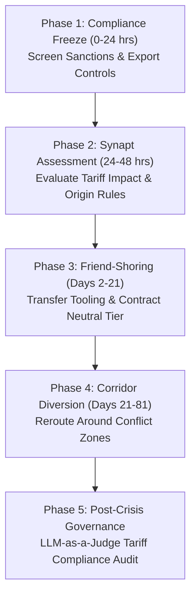

# Standard Operating Procedure: Geopolitical Disruption Response
## SOP-05: Sanctions, Tariffs & Regional Conflict Disruption Playbook

```
+----------------------------------------------------------------------------------------------------+
| PROCEDURE ID: SOP-05                  | VERSION: 2.1              | STATUS: ACTIVE                 |
| CLASSIFICATION: Geopolitical         | EFFECTIVE DATE: Oct 2026  | REVIEW CYCLE: Semi-Annual      |
| GOVERNING SYSTEM: Synapt Assistant    | DATABASE COHORT: 18,084   | BENCHMARK RESILIENCE: 79.05%   |
+----------------------------------------------------------------------------------------------------+
```

---

## 1. Scope & Incident Description

This SOP governs the strategic response, trade compliance verification, nearshoring rerouting, and permanent vendor transition when international trade is disrupted by sudden customs tariffs, trade embargoes, sovereign sanctions, maritime corridor closures (e.g., Red Sea, Strait of Malacca), or military conflict in supplier regions.

### Typical Root Causes
- Sudden implementation of high tariffs or retaliatory anti-dumping duties.
- Export controls, entity-list additions, or international sanctions prohibiting vendor dealings.
- Military actions, blockades, or airspace closures forcing extensive detour shipping routes.
- Nationalization or expropriation of raw material extraction assets.

---

## 2. Empirical Warehouse Baseline & Performance Benchmarks

Based on 18,084 recorded historical geopolitical disruptions in `v_disruption_details`:

- **Empirical Probability**: **18.1%** of all historical disruptions.
- **Mean Production Downtime**: **33.86%**
- **Mean Financial Revenue Loss**: **$2,691,690.60**
- **Mean Time to Full Recovery (MTFR)**: **81.2 days**
- **Empirical Strategy Effectiveness**:
  1. **Alternative Supplier**: Mean Resilience = **83.50%**, Avg Recovery = **67.1 days** *(Rank #1)*
  2. **Inventory Buffer**: Mean Resilience = **76.89%**, Avg Recovery = **72.8 days**
  3. **Customer Delay**: Mean Resilience = **75.75%**, Avg Recovery = **88.7 days**
  4. **Production Reroute**: Mean Resilience = **74.88%**, Avg Recovery = **99.2 days**
  5. **Combined Strategy**: Mean Resilience = **74.11%**, Avg Recovery = **105.8 days**

> [!WARNING]
> Geopolitical shocks exhibit high structural persistence (81.2 days average recovery). Temporary rerouting within the same region often fails due to secondary sanctions or regional conflict escalation. Establishing a qualified **Alternative Supplier** in a neutral or friendly trade zone yields an **83.50% resilience score** and cuts recovery by **14.1 days**.

---

## 3. Incident Severity Triage Matrix

```
+----------+--------------------+---------------------+------------------------+-----------------------+
| SEVERITY | CLASSIFICATION     | POLICY IMPACT       | ESTIMATED LOSS         | ESCALATION LEVEL      |
+----------+--------------------+---------------------+------------------------+-----------------------+
| Level 1  | Tariff Dispute     | 5% - 15% Duty Hike  | < $400,000 USD         | Trade Compliance Lead |
| Level 2  | Targeted Sanction  | Single sub-tier item| $400,000 - $1,200,000  | Procurement Director  |
| Level 3  | Entity List Block  | Direct Tier-1 vendor| $1,200,000 - $2,800,000| Crisis Response Team  |
| Level 4  | Corridor Closure   | Air/Sea zone closed | $2,800,000 - $4,800,000| VP Global Supply Chain|
| Level 5  | Active War/Embargo | Total trade ban     | > $4,800,000 USD       | General Counsel & CEO |
+----------+--------------------+---------------------+------------------------+-----------------------+
```

---

## 4. Phased Standard Operating Procedure



### Phase 1: Legal Compliance Screening & Asset Quarantine (Hours 0 – 24)
1. **Trade Sanction & Entity List Screening**: Run affected supplier and parent company entities against OFAC (US), EU Consolidated Sanctions, and relevant sovereign trade control databases.
2. **Immediate Freeze on Controlled Transactions**: If vendor is designated on an active trade restriction or Entity List, immediately freeze all outgoing payments, technical data transfers, and shipments to avoid criminal regulatory penalties.
3. **Inventory Transit Position Assessment**: Determine whether existing purchased goods are cleared through customs or impounded at border checkpoints.
4. **Trigger Synapt Ingestion**: Ingest incident parameters into `/api/v1/orchestrate` with categorical type `Geopolitical`.

### Phase 2: Agent-Assisted Assessment & Strategy Formulation (Hours 24 – 48)
1. **Impact Agent ML Run**: Review predicted downtime percentage, revenue loss, and TreeSHAP waterfall charts.
2. **Rules of Origin (ROO) & Tariff Engineering Audit**:
   - Assess if minor manufacturing transformations or sub-assembly steps can be rerouted to friendly trade treaty jurisdictions (e.g., USMCA, ASEAN, EU-FTA).
3. **Strategy Alignment**:
   - For total embargoes or war zones: Trigger mandatory **Permanent Supplier Change** and onboard secondary source immediately.
   - For tariff increases without export ban: Assess financial impact of absorbing duty vs. executing **Alternative Supplier** transition.

### Phase 3: Mitigation & Nearshoring Sourcing Shift (Days 2 – 21)
1. **Activate Friend-Shoring / Secondary Supplier**: Redirect PO volume to pre-qualified suppliers located in stable, friendly-trade jurisdictions.
2. **Maritime Corridor Rerouting**:
   - For Suez / Red Sea disruptions $\rightarrow$ Divert vessels via Cape of Good Hope (+10-14 days transit allowance).
   - For airspace restrictions $\rightarrow$ Reroute air cargo via polar or southern trans-continental corridors.
3. **Safety Stock Buffer Deployment**: Release strategic safety stocks to shield factory operations during extended maritime transit detours.

### Phase 4: Long-Term Supply Realignment (Days 21 – 81)
1. **Milestone 1 (Target: Day 21)**: Alternative supplier onboarding completed; pilot production lots qualified.
2. **Milestone 2 (Target: Day 45)**: First friend-shored shipments clear customs; factory operations stabilized at 60% throughput.
3. **Milestone 3 (Target: Day 65)**: Diverted cargo ships arrive via extended maritime routes; raw material pipeline stabilized.
4. **Milestone 4 (Target: Day 81)**: Full 100% throughput restored under diversified global footprint.

### Phase 5: Trade Governance & Regulatory Audit (Post Day 81)
1. **Customs Re-classification Audit**: Verify all harmonized tariff system (HTS) codes and origin certificates for newly on-boarded suppliers.
2. **Permanent Churn Confirmation**: Formally update ERP master vendor records to decommission high-risk embargoed suppliers.
3. **LLM-as-a-Judge Audit**: Execute automated audit review verifying zero regulatory violations during crisis diversion.

---

## 5. Decision Tree for Response Strategy Selection

```
Is the disruption caused by an active legal embargo / Entity List sanction?
├── YES
│   └── Sourcing from current vendor is legally barred!
│       └── Deploy 'Alternative Supplier' (Permanent friend-shoring transition)
└── NO (Tariff increase or transport corridor conflict)
    ├── Can goods be safely rerouted around the conflict zone?
    │   ├── YES ──> Deploy 'Combined Strategy' (Reroute transit corridor + Buffer stock)
    │   └── NO  ──> Deploy 'Alternative Supplier' in neutral trade territory
```

---

## 6. Trade Compliance & Sanctions Checklist

- [ ] Vendor entity and beneficial owners checked against OFAC, UK HMT, and EU sanctions lists within 4 hours.
- [ ] No technical data or ITAR/EAR restricted blueprints transmitted to restricted regions.
- [ ] Customs broker briefed on revised country of origin certificates (COO).
- [ ] Maritime war-risk insurance surcharges approved by Corporate Treasury.
- [ ] Secondary supplier qualified in a non-sanctioned sovereign jurisdiction.
