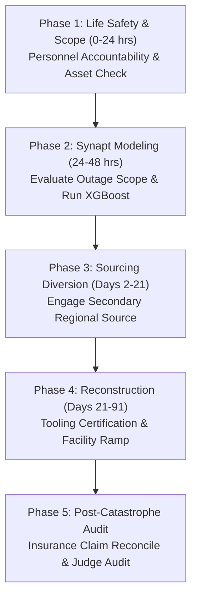

# Standard Operating Procedure: Natural Disaster Response
## SOP-06: Severe Weather, Earthquake & Environmental Catastrophe Playbook

```
+----------------------------------------------------------------------------------------------------+
| PROCEDURE ID: SOP-06                  | VERSION: 2.1              | STATUS: ACTIVE                 |
| CLASSIFICATION: Natural Disaster     | EFFECTIVE DATE: Oct 2026  | REVIEW CYCLE: Semi-Annual      |
| GOVERNING SYSTEM: Synapt Assistant    | DATABASE COHORT: 15,016   | BENCHMARK RESILIENCE: 78.37%   |
+----------------------------------------------------------------------------------------------------+
```

---

## 1. Scope & Incident Description

This SOP specifies emergency mobilization, physical damage assessment, humanitarian coordination, and supply chain continuity protocols when major natural events devastate supplier manufacturing plants, logistics hubs, or regional transportation infrastructure.

### Typical Root Causes
- Hurricanes, typhoons, and tropical cyclones causing structural devastation and storm surges.
- Earthquakes and seismic tsunamis damaging factory precision foundations and tooling.
- Major riverine flooding submerging industrial parks and roads.
- Wildfires, volcanic ash plumes shutting down regional airspace, or prolonged droughts disabling hydroelectric power grids.

---

## 2. Empirical Warehouse Baseline & Performance Benchmarks

Based on 15,016 recorded historical natural disasters in `v_disruption_details`:

- **Empirical Probability**: **15.0%** of all historical disruptions.
- **Mean Production Downtime**: **37.33%** *(Second highest across all disruption types)*
- **Mean Financial Revenue Loss**: **$3,039,002.47** *(Second highest financial damage)*
- **Mean Time to Full Recovery (MTFR)**: **90.6 days**
- **Empirical Strategy Effectiveness**:
  1. **Alternative Supplier**: Mean Resilience = **83.00%**, Avg Recovery = **74.8 days** *(Rank #1)*
  2. **Inventory Buffer**: Mean Resilience = **76.21%**, Avg Recovery = **78.8 days**
  3. **Customer Delay**: Mean Resilience = **75.66%**, Avg Recovery = **93.1 days**
  4. **Production Reroute**: Mean Resilience = **74.02%**, Avg Recovery = **110.2 days**
  5. **Combined Strategy**: Mean Resilience = **73.34%**, Avg Recovery = **117.9 days**

> [!CAUTION]
> Natural disasters involve wide regional devastation: infrastructure, roads, airports, and electrical grids are destroyed alongside vendor facilities. Relying solely on the vendor to rebuild leads to an average recovery of **110+ days**. Immediately triggering an **Alternative Supplier** located outside the catastrophe zone saves **35.4 days** of production downtime.

---

## 3. Incident Severity Triage Matrix

```
+----------+--------------------+---------------------+------------------------+-----------------------+
| SEVERITY | CLASSIFICATION     | PHYSICAL IMPACT     | ESTIMATED LOSS         | ESCALATION LEVEL      |
+----------+--------------------+---------------------+------------------------+-----------------------+
| Level 1  | Minor Weather Delay| 1 - 3 days closure  | < $350,000 USD         | Regional Logistics    |
| Level 2  | Localized Flood    | Structural minor lag| $350,000 - $1,200,000  | Category Manager      |
| Level 3  | Severe Storm/Quake | Heavy machinery down| $1,200,000 - $3,000,000| Crisis Response Team  |
| Level 4  | Major Catastrophe  | Facility destroyed  | $3,000,000 - $5,000,000| VP Supply Chain       |
| Level 5  | Regional Collapse  | Grid & transport out| > $5,000,000 USD       | C-Suite / Executive   |
+----------+--------------------+---------------------+------------------------+-----------------------+
```

---

## 4. Phased Standard Operating Procedure



### Phase 1: Personnel Safety & Physical Asset Assessment (Hours 0 – 24)
1. **Life Safety & Accountability Check**: Coordinate with supplier executive leadership to ensure workforce safety and facility security.
2. **Satellite & Drone Imagery Triage**: Inspect commercial satellite feeds and government emergency declarations (e.g., FEMA, civil protection agencies) to evaluate regional flooding and road washouts.
3. **In-Transit Inventory Audit**: Track freight stranded at local regional airports, train sidings, or seaports within the disaster perimeter.
4. **Trigger Synapt Ingestion**: Ingest incident parameters into `/api/v1/orchestrate` with categorical type `Natural Disaster`.

### Phase 2: Agent-Assisted Assessment & Strategy Formulation (Hours 24 – 48)
1. **Impact Agent ML Model Run**: Review predicted downtime percentage and revenue loss. Note that natural disasters typically rank high on `disruption_severity` and `production_impact_pct`.
2. **Infrastructure Grid Assessment**: Verify municipal power, water, gas, and telecommunications restoration estimates for the industrial zone.
3. **Strategy Alignment**:
   - If vendor facility is flooded/structurally condemned: Trigger **Alternative Supplier** immediately; do not wait for vendor cleanup.
   - If damage is confined to transport/power with inventory safe: Deploy **Inventory Buffer** and schedule expedited evacuation via heavy freight helicopters or specialized transport.

### Phase 3: Mitigation & Geographical Sourcing Shift (Days 2 – 21)
1. **Out-of-Region Sourcing Allocation**: Transfer purchase orders to pre-qualified suppliers located outside the affected meteorological/seismic zone.
2. **Tooling Recovery Protocol**: Once civil defense authorities clear site access, dispatch recovery engineers to inspect and extract specialized injection molds, dies, and calibration tools.
3. **Emergency Air Lift**: For critical sub-assemblies stored in undamaged sections of the facility, charter emergency cargo flights from the nearest operating international airport.

### Phase 4: Infrastructure Recovery & Phased Ramp (Days 21 – 91)
1. **Milestone 1 (Target: Day 21)**: Alternative supplier shipments commence deliveries to assembly plants.
2. **Milestone 2 (Target: Day 45)**: Affected supplier restores emergency generator power and cleans cleanrooms/assembly bays.
3. **Milestone 3 (Target: Day 70)**: Primary facility re-qualifies initial production lines; operates at 50% capacity.
4. **Milestone 4 (Target: Day 91)**: Full 100% throughput restored across blended primary and secondary supplier network.

### Phase 5: Post-Catastrophe Audit & Insurance Reconciliation (Post Day 91)
1. **Property & Business Interruption Insurance**: Compile proof of loss, extra expense records, and expedited freight invoices for insurance claim submission.
2. **Resilience Hardening Review**: Mandate that the affected supplier install elevated flood barriers, seismic dampers, and redundant power generators as conditions of future master contract renewals.
3. **LLM-as-a-Judge Audit**: Execute automated governance verification against company resilience and safety standards.

---

## 5. Decision Tree for Response Strategy Selection

```
Is the supplier manufacturing facility structurally intact with power?
├── YES
│   └── Are local transport routes (roads, rail, ports) navigable?
│       ├── YES ──> Deploy 'Inventory Buffer' + Expedite Local Logistics
│       └── NO  ──> Deploy 'Combined Strategy' (Reroute transport + Buffer stock)
└── NO (Facility flooded / destroyed / extended blackout)
    ├── Is an active Backup Supplier available?
    │   ├── YES ──> Deploy 'Alternative Supplier' (Execute emergency volume transfer)
    │   └── NO  ──> Deploy 'Production Reroute' (Reallocate manufacturing to sister plants)
```

---

## 6. Disaster Continuity Governance Checklist

- [ ] Geographic redundancy verified: primary and secondary suppliers located in distinct geological/climate zones (> 500 km apart).
- [ ] Comprehensive business interruption insurance coverage active with low waiting period deductibles.
- [ ] Emergency satellite communication kits provided to critical Tier-1 plants.
- [ ] Off-site backup of manufacturing CNC code, tool specifications, and calibration files maintained.
