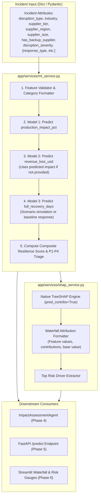

# Phase 3 Implementation Instructions: Predictive ML Engine & Explainable AI (SHAP)

This document provides complete, step-by-step instructions for building **Phase 3: Predictive ML Engine & Explainable AI (SHAP)** for the AI-Powered Supply Chain Disruption Assistant.

---

## 1. Executive Summary & Objective

In Phase 1 and Phase 2, we:
* Cleaned and normalized 100,000 supply chain disruption records.
* Pre-trained 3 XGBoost regressors saved to `models/`.
* Populated the MySQL database and created the unified view `v_disruption_details`.
* Built and verified the 2-step Synapt SQL Builder for historical cohort queries.

**The Goal of Phase 3**:
Build a fast, deterministic **Machine Learning & Attribution Layer** that accepts any incoming disruption incident (from a user query, alert, or automated ingestion) and:
1. Forecasts **Production Downtime %**, **Revenue Loss ($)**, and **Full Recovery Days**.
2. Dynamically chains predictions (feeding predicted downtime into revenue loss if actual downtime is unknown).
3. Computes the composite **Resilience Score** ($0\text{--}100\%$) and classifies the incident into **$P1$ to $P4$ Priority Levels**.
4. Generates local **TreeSHAP feature attributions** (waterfall data) to explain why the models predicted those outcomes.

---

## 2. Architecture & Component Interaction



---

## 3. Pre-Trained Models & Feature Specifications

All 3 models are serialized in `models/` using XGBoost JSON format:

| Target | Model File | Features Required | $R^2$ Score |
|---|---|---|---|
| **Production Impact %** | `models/production_impact_pct_model.json` | 7 base attributes | **0.70** |
| **Revenue Loss ($)** | `models/revenue_loss_usd_model.json` | 7 base attributes + `production_impact_pct` | **0.38** |
| **Full Recovery Days** | `models/full_recovery_days_model.json` | 7 base attributes + `response_type`, `response_time_days`, `partial_recovery_days`, `permanent_supplier_change` | **0.55** |

### Feature Types & Controlled Categories

XGBoost was trained with `enable_categorical=True` using pandas `category` dtypes:

* **`disruption_type`**: `['Factory Incident', 'Cyber Attack', 'Port Congestion', 'Labor Strike', 'Geopolitical', 'Natural Disaster']`
* **`industry`**: `['Pharmaceuticals', 'Electronics', 'Consumer Goods', 'Automotive', 'Aerospace']`
* **`supplier_tier`**: `['1', '2', '3', '4']` (as categorical strings)
* **`supplier_region`**: `['Asia-Pacific', 'Europe', 'South America', 'North America', 'Africa/Middle East']`
* **`supplier_size`**: `['Large', 'Medium', 'Small']`
* **`disruption_severity`**: `['1', '2', '3', '4', '5']` (as categorical strings)
* **`has_backup_supplier`**: `int64` (`1` for True, `0` for False)
* **`response_type`**: `['Customer Delay', 'Alternative Supplier', 'Production Reroute', 'Inventory Buffer', 'Combined Strategy']`
* **`permanent_supplier_change`**: `int64` (`1` for True, `0` for False)
* **`response_time_days`**: `int64` (default benchmark: `10` days)
* **`partial_recovery_days`**: `int64` (default benchmark: `14` days)

---

## 4. Step-by-Step Implementation Instructions

### Step 1: Create `app/services/ml_service.py`

#### Responsibilities:
1. Singleton or cached loading of the 3 XGBoost models (`xgboost.XGBRegressor()`).
2. Input validation and transformation into pandas DataFrame with exact categorical dtypes.
3. Chained multi-model inference.
4. Composite Resilience Score calculation.
5. Prioritization triage level calculation ($P1$ to $P4$).
6. Structured output dictionary.

#### Code Architecture & Method Signatures:

```python
# app/services/ml_service.py

class MLService:
    def __init__(self, models_dir: str = "models"):
        # Load the 3 models
        self.impact_model = ...
        self.loss_model = ...
        self.recovery_model = ...
        self.metrics = ... # from models/metrics.json

    def format_input_df(self, incident: dict, target: str) -> pd.DataFrame:
        """
        Converts incident dict into a 1-row DataFrame matching the exact 
        feature schema and categorical dtypes required by the specified model.
        """
        ...

    def predict_impact(self, incident: dict) -> float:
        """Forecasts production_impact_pct (0.0 to 100.0)."""
        ...

    def predict_revenue_loss(self, incident: dict, impact_pct: float | None = None) -> float:
        """Forecasts revenue_loss_usd. Uses predicted impact if not provided."""
        ...

    def predict_recovery_days(self, incident: dict, scenario_overrides: dict | None = None) -> float:
        """Forecasts full_recovery_days under default or simulated response options."""
        ...

    def assess_incident(self, incident: dict) -> dict:
        """
        End-to-end evaluation:
          1. Predicts downtime, revenue loss, and recovery days.
          2. Computes Resilience Score.
          3. Computes Prioritization Level (P1-P4).
          4. Returns comprehensive assessment payload.
        """
        ...
```

---

### Step 2: Implement Mathematical Formulations in `ml_service.py`

#### 1. Composite Resilience Score Formula
Standardized 4-part formula adopted from Kaggle benchmark analysis:

$$\text{Resilience Score} = \left[ 0.4 \times (1 - \text{norm\_recovery}) + 0.4 \times (1 - \text{norm\_loss}) + 0.1 \times \text{backup\_bonus} - 0.1 \times \text{penalty} \right] \times 100$$

Where:
* $\text{norm\_recovery} = \min\left(1.0, \frac{\text{full\_recovery\_days}}{120.0}\right)$
* $\text{norm\_loss} = \min\left(1.0, \frac{\text{revenue\_loss\_usd}}{100,000,000.0}\right)$
* $\text{backup\_bonus} = 1.0 \text{ if } \text{has\_backup\_supplier} \text{ else } 0.0$
* $\text{penalty} = 1.0 \text{ if } (\text{severity} \ge 4 \text{ and not } \text{has\_backup\_supplier}) \text{ else } 0.0$
* Clamped strictly between $0.0\%$ and $100.0\%$.

#### 2. Prioritization Triage Logic ($P1$ to $P4$)
* **$P1\text{-Critical}$**: `severity >= 4` AND (`production_impact_pct > 50.0` OR `revenue_loss_usd > 5,000,000.0`)
* **$P2\text{-High}$**: `severity >= 3` AND (`production_impact_pct > 35.0` OR `revenue_loss_usd > 1,000,000.0`)
* **$P4\text{-Low}$**: `severity <= 2` AND `production_impact_pct < 20.0`
* **$P3\text{-Medium}$**: All other incidents.

---

### Step 3: Create `app/services/shap_service.py`

#### Responsibilities:
1. Compute exact local SHAP contributions using native XGBoost C++ TreeSHAP:
   ```python
   dmat = xgb.DMatrix(X_df, enable_categorical=True)
   contribs = booster.predict(dmat, pred_contribs=True)
   # contribs shape: (1, num_features + 1), where the last column is the base_value (bias)
   ```
2. Decompose predictions into:
   * **Base Value**: Dataset average prediction.
   * **Feature Contributions**: Signed impact ($+$ pushes value up, $-$ reduces value).
   * **Final Prediction**: $\text{Base Value} + \sum \text{Contributions}$.
3. Identify top 3 primary risk drivers (highest positive contributors to impact or loss).
4. Format output into a clean JSON structure ready for waterfall rendering in Streamlit.

#### Method Signatures:

```python
# app/services/shap_service.py

class SHAPService:
    def __init__(self, ml_service: MLService):
        self.ml_service = ml_service

    def explain_impact(self, incident: dict) -> dict:
        """
        Returns feature contributions for production_impact_pct:
        {
            "target": "production_impact_pct",
            "base_value": 31.44,
            "predicted_value": 52.80,
            "features": [
                {"name": "disruption_severity", "value": "4", "contribution": +12.35},
                {"name": "has_backup_supplier", "value": 0, "contribution": +6.40},
                ...
            ],
            "top_risk_drivers": ["disruption_severity", "has_backup_supplier"]
        }
        """
        ...

    def explain_loss(self, incident: dict, impact_pct: float | None = None) -> dict:
        """Returns feature contributions for revenue_loss_usd."""
        ...

    def get_risk_driver_narrative(self, explanation: dict) -> str:
        """Generates a concise 1-sentence root-cause explanation for LLM agent context."""
        ...
```

---

### Step 4: Add CLI Verification & Automated Unit Tests

In both `ml_service.py` and `shap_service.py`, include an executable `if __name__ == "__main__":` block that tests:

1. **A Severe Incident Case**:
   ```python
   severe_case = {
       "disruption_type": "Cyber Attack",
       "industry": "Electronics",
       "supplier_tier": "2",
       "supplier_region": "Asia-Pacific",
       "supplier_size": "Large",
       "has_backup_supplier": 0,
       "disruption_severity": "4",
   }
   ```
   * Expected: $P1\text{-Critical}$ triage, downtime $> 50\%$, significant positive SHAP attribution on `disruption_severity` and lack of backup.

2. **A Mild Incident Case**:
   ```python
   mild_case = {
       "disruption_type": "Port Congestion",
       "industry": "Consumer Goods",
       "supplier_tier": "1",
       "supplier_region": "North America",
       "supplier_size": "Medium",
       "has_backup_supplier": 1,
       "disruption_severity": "1",
   }
   ```
   * Expected: $P4\text{-Low}$ or $P3\text{-Medium}$, downtime $< 25\%$, high resilience score ($> 80\%$).

3. **Mathematical Invariant Check**:
   * Verify that for every SHAP explanation:
     $$\text{base\_value} + \sum \text{contributions} == \text{predicted\_value} \pm 10^{-4}$$

---

## 5. Verification Commands

To verify Phase 3 after implementation:

```powershell
# 1. Test ML inference and scoring
python -m app.services.ml_service

# 2. Test TreeSHAP explainability
python -m app.services.shap_service
```

Both commands should complete with zero errors and print formatted predictions, scores, and waterfall tables.

---

## 6. Next Transition: Moving to Phase 4

Once Phase 3 is verified:
* `ImpactAgent` in Phase 4 will directly import `ml_service` and `shap_service`.
* When an incident is triaged, `ImpactAgent` calls `assess_incident()` and `explain_loss()`, embedding the quantitative forecasts and SHAP drivers into the prompt context for `ResponseAgent` and `LLMJudge`.
