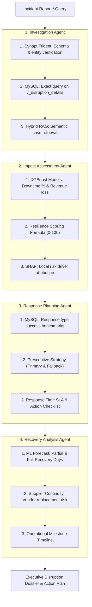

# AI-Powered Supply Chain Disruption Assistant with Synapt
## System Architecture & Phased Implementation Plan

---

## 1. Executive Summary & Purpose

The objective of **Project 9** is to build an intelligent, end-to-end supply chain disruption analysis and recovery assistant. The system empowers operations teams to investigate emerging disruption incidents, prioritize risks, predict financial and downtime impacts, evaluate historical response strategies, and generate actionable recovery plans.

The system combines four foundational technologies:
1. **Synapt Trident MCP**: Knowledge Graph & Schema Intelligence layer for entity validation, ontology discovery, and concept mapping.
2. **MySQL Relational Warehouse (`supply_chain_db`)**: The source of truth holding 100,000 historical disruption records across four normalized tables and an analytics view.
3. **Pre-trained Predictive ML Models (XGBoost)**: Fast, data-driven inference forecasting production downtime %, financial loss ($ USD), and recovery timelines.
4. **Hybrid RAG & Multi-Agent Orchestration**: Specialized autonomous agents (Investigation, Impact, Planning, Recovery) guided by input guardrails and evaluated by DeepEval and LLM-as-Judge.

---

## 2. Dual-Layer Data & Intelligence Architecture

A core design strength of this system is separating **Schema / Ontological Knowledge (Synapt)** from **Empirical Relational Data (MySQL)**:

```
                                 ┌──────────────────────────────────────────────┐
                                 │       Incoming Disruption Query / Incident   │
                                 └──────────────────────┬───────────────────────┘
                                                        │
                      ┌─────────────────────────────────┴─────────────────────────────────┐
                      ▼                                                                   ▼
       ┌───────────────────────────────┐                                   ┌───────────────────────────────┐
       │     Synapt Trident (MCP)      │                                   │     XGBoost ML Models         │
       │   Knowledge Graph & Schema    │                                   │   Impact, Revenue & Recovery  │
       │ (Understands entities/classes)│                                   │   (Instant predictive risk)   │
       └──────────────┬────────────────┘                                   └──────────────┬────────────────┘
                      │                                                                   │
                      ▼                                                                   │
       ┌───────────────────────────────┐                                                  │
       │      Synapt SQL Builder       │                                                  │
       │  (Value Grounding & Safe SQL) │                                                  │
       └──────────────┬────────────────┘                                                  │
                      │                                                                   │
                      ▼                                                                   │
       ┌───────────────────────────────┐                                                  │
       │   MySQL (`supply_chain_db`)   │                                                  │
       │  Unified View & Assessments   │                                                  │
       │  `v_disruption_details` (100k)│                                                  │
       └──────────────┬────────────────┘                                                  │
                      │                                                                   │
                      └─────────────────────────────────┬─────────────────────────────────┘
                                                        │
                                                        ▼
                                       ┌──────────────────────────────────┐
                                       │   Multi-Agent Synthesis Engine   │
                                       │ (Investigation, Impact, Response,│
                                       │  Recovery Dossier + Action Plan) │
                                       └──────────────────────────────────┘
```

### Component Roles & Responsibilities

| Component | Technology | Primary Function |
|---|---|---|
| **Knowledge Graph** | **Synapt Trident MCP** | Discovers valid attributes, confirms data dictionary relationships, maps user terms to database fields, and provides semantic graph validation. |
| **SQL Builder** | **`app/services/sql_builder.py`** | Translates natural language into safe, parameterized `SELECT` queries with deterministic entity resolution and value grounding. |
| **Relational Warehouse** | **MySQL (`supply_chain_db`)** | Stores 100k empirical records (`disruptions`, `impact`, `response`, `recovery`, `incident_assessments`, `v_disruption_details`). Executes structured filters and aggregate analytics. |
| **Predictive ML** | **XGBoost Regressors (`models/`)** | Instant quantitative prediction for `production_impact_pct`, `revenue_loss_usd`, and `full_recovery_days`. |
| **Explainable AI (XAI)** | **TreeSHAP** | Generates local waterfall feature attributions explaining root-cause risk drivers for each prediction. |
| **Multi-Agent Pipeline** | **LangChain / Custom Orchestrator** | Coordinates 4 specialized agents to investigate, quantify, prescribe responses, and forecast recovery. |
| **Evaluation Layer** | **DeepEval & LLM-as-Judge** | Automatically scores retrieval relevancy, faithfulness, response feasibility, and safety guardrails. |
| **Serving & UI** | **FastAPI & Streamlit** | REST microservice endpoints + interactive operations dashboard. |

---

## 3. The 4 Multi-Agent Roles & Data Mapping



### Agent 1: Investigation Agent (Triage, Classification & Retrieval)
* **Goal**: Validate input parameters, classify the disruption, and pull matching empirical cases.
* **Workflow**:
  1. Calls **Synapt MCP** (`trident_search` / `trident_get_schema`) to map user input to formal ontology terms.
  2. Uses **Synapt SQL Builder (`app/services/sql_builder.py`)** with Value Grounding from `supply_chain_data_dictionary.md` to construct safe, parameterized SQL.
  3. Queries **MySQL `supply_chain_db`** on `v_disruption_details` for exact cohort records matching `disruption_type`, `industry`, `supplier_tier`, and `supplier_region`.
* **Output Artifact**: Validated Disruption Context + Cohort Historical Statistics + Top-K Matched Incident Cases.

### Agent 2: Impact Assessment Agent (Quantification, Resilience & XAI)
* **Goal**: Measure financial exposure, operational severity, and root-cause risk drivers.
* **Workflow**:
  1. Feeds incident features into trained **XGBoost models** (`production_impact_pct_model.json`, `revenue_loss_usd_model.json`).
  2. Calculates the composite **Resilience Score** ($0–100$) using the Kaggle benchmark formula:
     $$\text{Resilience Score} = [0.4 \times (1 - \text{norm\_recovery}) + 0.4 \times (1 - \text{norm\_loss}) + 0.1 \times \text{backup} - 0.1 \times \text{penalty}] \times 100$$
  3. Computes **SHAP (SHapley Additive exPlanations)** values to identify top drivers (e.g., lack of backup supplier, tier 1 single point of failure).
* **Output Artifact**: Predicted Impact Bounds (downtime % and financial loss $), Resilience Score, Prioritization Triage Level ($P1$–$P4$), and SHAP Risk Factor Breakdown.

### Agent 3: Response Planning Agent (Empirical Mitigation Strategy)
* **Goal**: Formulate data-backed mitigation actions based on historical success rates.
* **Workflow**:
  1. Executes aggregate benchmark queries on **MySQL `supply_chain_db`**:
     ```sql
     SELECT response_type,
            AVG(response_time_days) AS avg_response_time,
            AVG(production_impact_pct) AS avg_downtime,
            AVG(revenue_loss_usd) AS avg_financial_loss,
            AVG(full_recovery_days) AS avg_recovery_days
     FROM v_disruption_details
     WHERE disruption_type = :disruption_type AND supplier_tier = :supplier_tier
     GROUP BY response_type
     ORDER BY avg_financial_loss ASC;
     ```
  2. Compares response efficacy (`Alternative Supplier` vs `Production Reroute` vs `Inventory Buffer`).
  3. Establishes a **Response SLA** based on the sensitivity curve of `response_time_days` vs final loss.
* **Output Artifact**: Recommended Primary Strategy, Contingency Fallback, Operational Step-by-Step Checklist, and Historical Efficacy Comparison Table.

### Agent 4: Recovery Analysis Agent (Forecasting & Vendor Continuity)
* **Goal**: Project milestone recovery schedules and assess supplier contract continuity.
* **Workflow**:
  1. Evaluates `full_recovery_days_model.json` to forecast days to partial and full operational restoration.
  2. Queries historical replacement rates in MySQL (`permanent_supplier_change`) to compute vendor stability probability.
  3. Constructs a milestone roadmap: Incident Day $0 \rightarrow$ Response Implemented $\rightarrow$ Partial Recovery $\rightarrow$ Full Operational Normalcy.
* **Output Artifact**: Target Milestone Schedule, Vendor Continuity Risk Rating, and Post-Recovery Audit Protocol.

---

## 4. Secure Database Access Design

To ensure full credential security:
* **Zero Hardcoded Secrets**: All credentials reside in the `.env` file (loaded via `python-dotenv`).
* **Connection Layer**: A standalone database module (`db_service.py`) connects via SQLAlchemy using environment variables:
  ```
  DB_HOST = os.getenv("DB_HOST")
  DB_PORT = os.getenv("DB_PORT", 3306)
  DB_USER = os.getenv("DB_USER")
  DB_PASS = os.getenv("DB_PASSWORD")
  DB_NAME = "supply_chain_db"
  ```
* **Read-Only Analytical Queries**: All agent queries target `v_disruption_details` or standard `SELECT` aggregations with parameter binding (preventing SQL injection).

---

## 5. Phased Implementation Roadmap

```
[Phase 1: DB & MCP Client] ──> [Phase 2: Ontology, DB & SQL Builder] ──> [Phase 3: ML & SHAP Engine]
                                                                                        │
[Phase 6: Presentation & Deck]  <── [Phase 5: FastAPI & DeepEval]    <── [Phase 4: Multi-Agent Engine]
```

### Phase 1: Database Connector & Synapt MCP Client Layer — ✅ Done
- Build `app/services/db_service.py` to securely query `supply_chain_db` and `v_disruption_details` via `.env`.
- Wrap Synapt MCP calls (`trident_query`, `trident_get_schema`, `trident_search`) into an asynchronous client utility `app/services/synapt_service.py`.
- Implement safe caching for schema lookups.

### Phase 2: Schema Grounding, Database Enrichment & Synapt SQL Builder — 🔄 In Progress
- [x] Author comprehensive ground-truth ontology & data dictionary (`project_docs/supply_chain_data_dictionary.md`).
- [x] Create `incident_assessments` table in local MySQL `supply_chain_db` (`app/services/db_service.py`).
- [x] Batch-compute and load 100,000 historical resilience scores, prioritization levels, risk drivers, and playbook strategies into `incident_assessments` (`app/services/populate_assessments.py`).
- [x] Update unified view `v_disruption_details` in MySQL to join `incident_assessments` fields (`resilience_score`, `prioritization_level`, `top_risk_driver`, `recommended_strategy`).
- [ ] Build **Synapt SQL Builder (`app/services/sql_builder.py`)**:
  - Entity Resolution / Value Grounding engine mapping synonyms (e.g. "ransomware in APAC") to exact database classes (`Cyber Attack`, `Asia-Pacific`).
  - Graph-guided SQL synthesis using `SynaptService` schema knowledge.
  - SQL safety guardrails (strict `SELECT` enforcement, table whitelisting, limit injection).
  - Analytical execution layer returning structured cohort rows to agents.

### Phase 3: Predictive ML Engine & Explainable AI (SHAP)
- Build `app/services/ml_service.py`:
  - Load the 3 pre-trained XGBoost models (`production_impact_pct`, `revenue_loss_usd`, `full_recovery_days`).
  - Implement live inference pipeline for newly reported incidents.
  - Implement on-the-fly Kaggle composite resilience scoring and $P1$–$P4$ prioritization triage.
- Build `app/services/shap_service.py`:
  - TreeSHAP explainer for local feature attributions and waterfall plot generation.

### Phase 4: Multi-Agent Orchestration & LLM-as-Judge
- Implement Pydantic input guardrails (boundary validations, schema enforcement, prompt injection detection).
- Implement the 4 specialized agent classes (`app/agents/`):
  1. `InvestigationAgent`: Query parsing, Synapt schema verification, SQL builder cohort retrieval.
  2. `ImpactAgent`: ML inference, resilience scoring, SHAP risk drivers.
  3. `ResponseAgent`: SQL response benchmarking on `v_disruption_details`, scenario playbook matching.
  4. `RecoveryAgent`: Milestone forecasting, supplier continuity risk assessment.
- Implement master workflow orchestrator (`app/agents/coordinator.py`).
- Implement **LLM-as-Judge** validator checking feasibility, safety, and domain alignment.

### Phase 5: FastAPI Microservice & DeepEval Quality Suite
- Expose REST API endpoints (`app/main.py`):
  - `POST /api/v1/disruptions/classify` — Taxonomy classification.
  - `POST /api/v1/disruptions/query-sql` — Natural language to SQL query execution.
  - `POST /api/v1/disruptions/predict` — ML prediction, resilience score & SHAP drivers.
  - `POST /api/v1/disruptions/analyze` — Full 4-agent end-to-end investigation dossier.
  - `POST /api/v1/feedback` — Store operator validations and continuous improvement notes.
- DeepEval benchmark suite measuring Faithfulness, Answer Relevancy, and Contextual Precision.

### Phase 6: Streamlit Operations Dashboard & Final Deliverables
- Build interactive Streamlit Dashboard (`app/ui/dashboard.py`):
  - Incident entry form & triage ranking badges ($P1$–$P4$).
  - Gauge cards for downtime %, financial loss $, and resilience score.
  - Interactive SHAP waterfall chart.
  - Historical cohort comparison table.
  - Multi-agent execution trace tabs and feedback submission.
- Architecture diagram export and 10-minute panel presentation slide deck.

---

## 6. Implementation Status (Running Summary)

### Data Preparation & Predictive ML (`preprocessing&training/`) — ✅ Done
- **`01_data_prep.ipynb`**: Cleans 100k rows, normalizes types, validates bounds, saves `data/processed/disruptions_clean.parquet`.
- **`02_train_models.ipynb`**: Trains 3 XGBoost regressors (`production_impact_pct` $R^2=0.70$, `revenue_loss_usd` $R^2=0.38$, `full_recovery_days` $R^2=0.55$). Saves models in `models/`.
- **`03_tier_impact_analysis.ipynb`**: Correlation & ANOVA tests demonstrating Tier-1 immediate impact vs. Tier-3/4 extended recovery ripple.
- **Kaggle Research Integration (`preprocessing&training/internet/`)**: Incorporated empirical findings from 3 Kaggle notebooks, adopting the standardized 4-part composite Resilience Score formula and scenario playbooks.

### Phase 1: Database Connector & Synapt MCP Client Layer — ✅ Done
- **`app/services/db_service.py`**: SQLAlchemy connector for local MySQL `supply_chain_db` (`localhost:3306`).
- **`app/services/synapt_service.py`**: Async (`httpx`) client for Synapt Trident MCP with lazy auth, session caching, 401 token refresh, and typed wrapper methods.

### Phase 2: Schema Grounding, Database Enrichment & Synapt SQL Builder — 🔄 In Progress
- **`project_docs/supply_chain_data_dictionary.md`**: Created ground-truth ontology, 33 discrete categorical classes, synonym mappings, and SQL rules. — ✅ Done
- **`incident_assessments` Table**: Created in MySQL `supply_chain_db` with all fields and indices. — ✅ Done
- **Historical Ingestion**: Batch-computed resilience scores and prioritization tiers for all 100,000 records; loaded in 13.4s via `app/services/populate_assessments.py`. — ✅ Done
- **`v_disruption_details` View**: Updated in MySQL to join `incident_assessments` (`resilience_score`, `prioritization_level`, `top_risk_driver`, `recommended_strategy`). Verified live! — ✅ Done
- **`app/services/sql_builder.py`**: Next up — entity resolution, graph-guided SQL generation, safety guardrails, and query execution.

### Next Milestone
Complete `app/services/sql_builder.py` and test natural language to SQL query execution against `v_disruption_details`.
